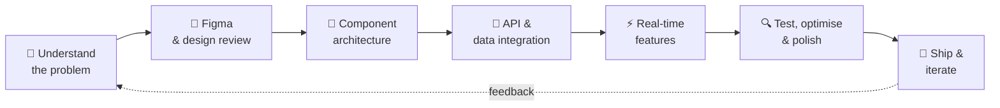

<!-- ===================== HEADER ===================== -->

 

<!-- Avatar (circular crop via wsrv.nl).
     Tip: LinkedIn image links expire. For a permanent avatar, upload the photo to your repo
     (e.g. assets/avatar.jpg) and replace the src below with:
     https://wsrv.nl/?url=https://raw.githubusercontent.com/Badhan092/Badhan092/main/assets/avatar.jpg&w=400&h=400&fit=cover&mask=circle -->

 

 

 

<!-- ===================== NAV ===================== -->

[**About**](#-about-me) · [**What I Do**](#-what-i-do) · [**Workflow**](#-how-i-build) · [**Stack**](#%EF%B8%8F-tech-stack) · [**Projects**](#-featured-projects) · [**Principles**](#-engineering-principles) · [**Roadmap**](#-currently-working-on--learning) · [**Stats**](#-github-analytics) · [**Contact**](#-lets-connect)

---

## 👋 About Me

> *"I enjoy the space where design meets engineering, where a good idea becomes an interface people actually enjoy using."*

I'm a **frontend developer** focused on building modern, responsive, and accessible web experiences. I work primarily with **React.js** and **Next.js**, and I'm especially interested in **UI engineering, performance optimization, and real-time web applications**.

I like owning the full frontend journey: understanding the problem, translating Figma designs into clean components, integrating APIs, handling real-time data, and polishing the details that make an app feel fast and intuitive.

| 🔭 Focus | ⚡ Strength | 🌐 Interest | 🌱 Mindset |
|:---:|:---:|:---:|:---:|
| Modern web apps | Design → code | Real-time UX | Always learning |

---

## 💼 What I Do

<table>
  <tr>
    <td width="50%" valign="top">

### 🎨 UI Engineering
Building reusable, responsive component systems that stay consistent across screens and devices.

- Pixel-accurate Figma → React implementation
- Responsive, mobile-first layouts
- Accessible, semantic markup
- Scalable styling with Tailwind & SCSS

    </td>
    <td width="50%" valign="top">

### ⚙️ Application Logic
Connecting interfaces to real data and making complex flows feel simple.

- REST API integration
- Multi-step forms & validation (e.g. OTP flows)
- State management & data fetching
- Error, loading, and empty states done right

    </td>
  </tr>
  <tr>
    <td width="50%" valign="top">

### ⚡ Real-Time Experiences
Creating live, interactive features that respond instantly.

- WebSocket-based communication
- Matchmaking & waiting-room flows
- Live state synchronisation in the UI
- Smooth interaction under changing data

    </td>
    <td width="50%" valign="top">

### 🚀 Performance & Quality
Shipping fast, maintainable code that's easy to extend.

- Next.js rendering & routing patterns
- Component architecture & code organisation
- Performance-minded development
- Version control with Git & GitHub

    </td>
  </tr>
</table>

---

## 🧭 How I Build

---

## 🛠️ Tech Stack

### Frontend

### Tools & Workflow

 

| Category | Technologies | Experience |
|---|---|---|
| **Languages** | JavaScript (ES6+), HTML5, CSS3 | 🟣 Daily driver |
| **Frameworks** | React.js, Next.js | 🟣 Daily driver |
| **Styling** | Tailwind CSS, SCSS | 🟣 Daily driver |
| **Integration** | REST APIs, WebSockets | 🔵 Confident |
| **Design handoff** | Figma | 🔵 Confident |
| **Tooling** | Git, GitHub, npm | 🔵 Confident |

🟣 Daily driver &nbsp;·&nbsp; 🔵 Confident &nbsp;·&nbsp; 🟢 Exploring

---

## 🚀 Featured Projects

<table>
  <tr>
    <td width="33%" valign="top">
      <h3>🚌 Dhaka Bus Finder</h3>
      
A commuter-focused route discovery tool that helps people explore Dhaka bus routes and find useful transit information quickly.

      

        
        
        
      

      Route search · Transit data · Mobile-first UI
    </td>
    <td width="33%" valign="top">
      <h3>🏍️ Road Rush</h3>
      
A multiplayer bike-racing experience with level selection, player waiting rooms, and real-time matchmaking flows.

      

        
        
        
      

      Real-time · Matchmaking · Interactive UI
    </td>
    <td width="33%" valign="top">
      <h3>🎉 Cirkle Mega Campaign</h3>
      
A campaign registration experience with user details, location selection, image upload, and OTP verification.

      

        
        
        
      

      Multi-step form · OTP · Image upload
    </td>
  </tr>
</table>

<b>🚌 Dhaka Bus Finder: project details</b>

 

| | |
|---|---|
| **Problem** | Commuters in Dhaka struggle to find reliable, easy-to-read bus route information. |
| **Solution** | A fast, searchable, responsive interface for exploring routes and transit info. |
| **Tech** | Next.js, JavaScript, responsive UI |
| **Highlights** | Route search · Transit data presentation · Mobile-friendly layout |
| **Links** | 🔗 Repo: *add link* · 🌐 Live demo: *add link* |

<b>🏍️ Road Rush: project details</b>

 

| | |
|---|---|
| **Problem** | Multiplayer games need instant, trustworthy feedback while players wait and match up. |
| **Solution** | A real-time UI covering level selection, waiting rooms, and matchmaking. |
| **Tech** | React, Next.js, WebSockets, API integration |
| **Highlights** | Live player state · Matchmaking flow · Interactive, game-like UI |
| **Links** | 🔗 Repo: *add link* · 🌐 Live demo: *add link* |

<b>🎉 Cirkle Mega Campaign: project details</b>

 

| | |
|---|---|
| **Problem** | Campaign sign-ups lose users when forms are long, confusing, or unreliable. |
| **Solution** | A guided registration flow with validation, location selection, upload, and OTP verification. |
| **Tech** | React, form handling, API integration, responsive design |
| **Highlights** | User details · Location picker · Image upload · OTP verification |
| **Links** | 🔗 Repo: *add link* · 🌐 Live demo: *add link* |

---

## 📐 Engineering Principles

<table>
  <tr>
    <td align="center" width="25%">🧼 <b>Clean code</b> Readable, maintainable, easy to hand off</td>
    <td align="center" width="25%">📱 <b>Responsive first</b> Great on every screen size</td>
    <td align="center" width="25%">♿ <b>Accessible</b> Semantic HTML & usable by everyone</td>
    <td align="center" width="25%">⚡ <b>Performance-minded</b> Fast load, smooth interactions</td>
  </tr>
</table>

---

## 📌 Currently Working On & Learning

**Working on**
- [x] Building polished, responsive frontend applications
- [x] Creating intuitive user experiences for real-world problems
- [ ] Improving React & Next.js performance and architecture
- [ ] Exploring better patterns for real-time application features

**Next up** *(edit this list to match your goals)*
- [ ] TypeScript for safer, more scalable codebases
- [ ] Testing with Jest / React Testing Library
- [ ] Advanced Next.js patterns (server components, caching)
- [ ] Web performance & Core Web Vitals

---

## 💬 Ask Me About

---

## 📊 GitHub Analytics

 

 

 

---

## 🤝 Let's Connect

I'm open to **frontend roles, freelance projects, and collaborations**, especially around React, Next.js, and real-time web apps.

| Channel | Link |
|:---:|:---:|
| 💼 LinkedIn | [linkedin.com/in/badhanchowdhury](https://linkedin.com/in/badhanchowdhury/) |
| 📧 Email | [badhan092@gmail.com](mailto:badhan092@gmail.com) |
| 🐙 GitHub | [@Badhan092](https://github.com/Badhan092) |
| 🌐 Portfolio | [Visit portfolio](https://vercel.com/badhan092s-projects) |

 

 

⭐ Thanks for visiting my profile! Feel free to explore my repositories and connect.

